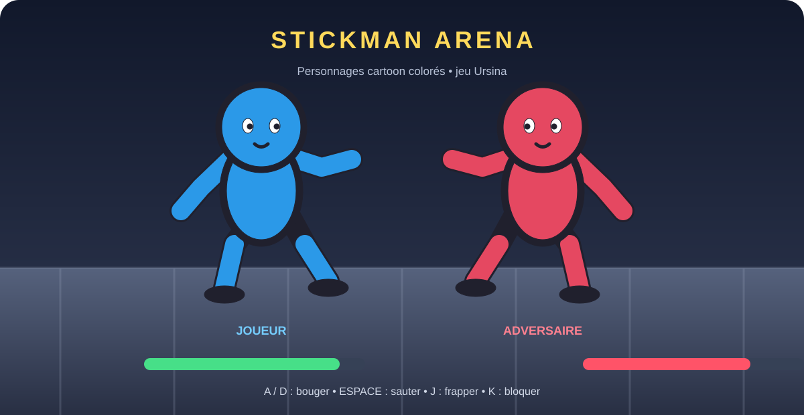

# Stickman Arena — Ursina

Jeu de combat local en 2.5D avec deux personnages cartoon aux formes rondes et aux couleurs vives, inspirés du style arcade des jeux de party : grosse tête, petit corps, visage expressif et membres colorés articulés. Les personnages et le décor sont dessinés avec Ursina, sans Pygame et sans images externes.



## Installation

Prérequis : Python 3.9 ou plus récent.

```bash
python -m pip install -r requirements.txt
python main.py
```

## Commandes

- **A / D** ou **← / →** : se déplacer
- **Espace** : sauter
- **J** ou **F** : frapper
- **K** ou **Maj** : bloquer (maintenir)
- **Échap** : quitter

Les barres de vie affichent l'état des combattants. Après un K.-O., le round suivant démarre automatiquement.
